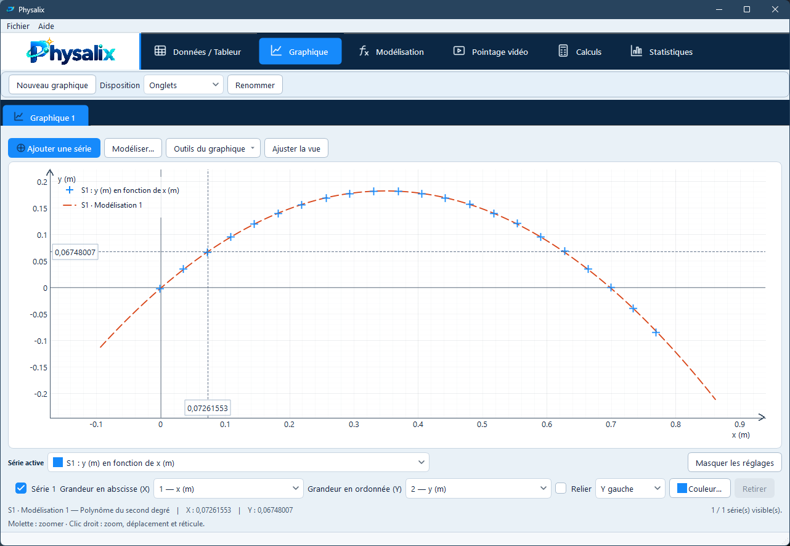
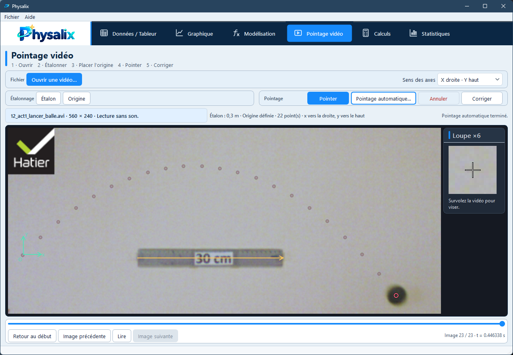
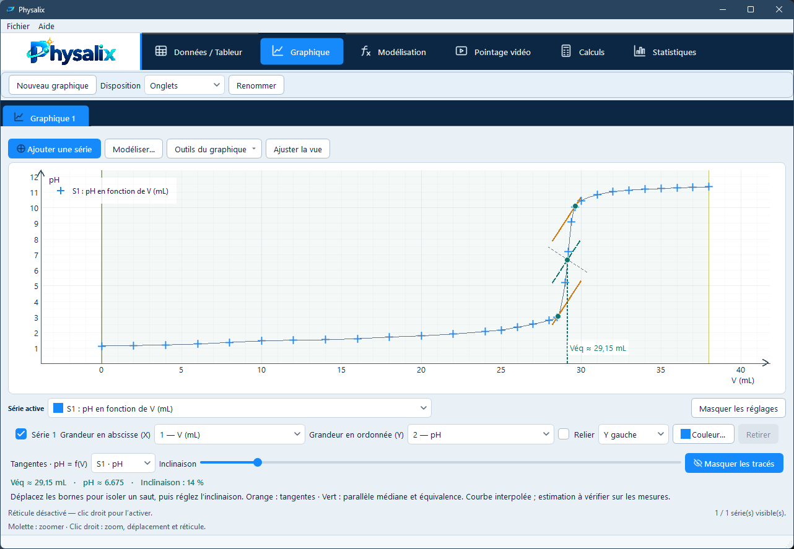
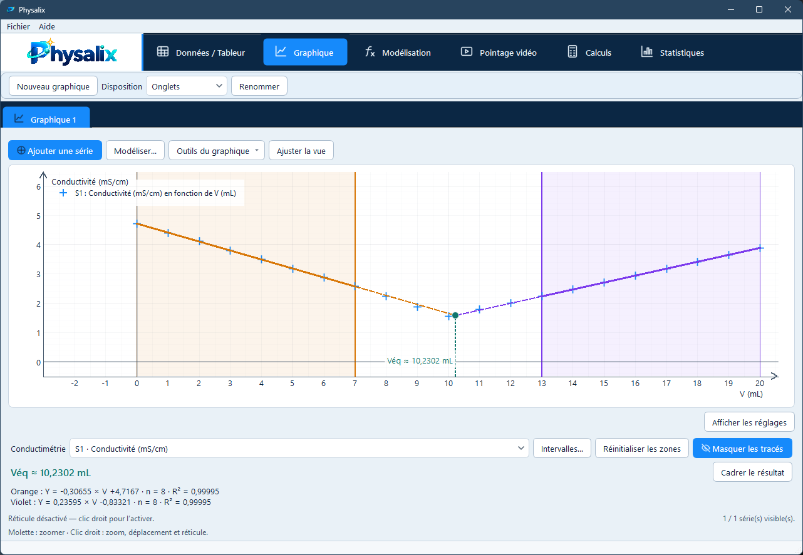

# Physalyx

**Physalyx** est un logiciel libre de physique-chimie pour Windows. Conçu notamment pour l'enseignement, il rassemble dans une même application les outils nécessaires pour saisir, visualiser, analyser et modéliser des données expérimentales.

## Télécharger Physalyx

**[Télécharger la dernière version pour Windows](https://github.com/jeansittler/Physalyx/releases/latest)**

L'installateur Windows est signé numériquement avec un certificat **Certum**. Physalyx peut ensuite rechercher les nouvelles versions et proposer leur installation.

Physalyx succède à **Physalix**. La mise à niveau depuis les installations existantes est prise en charge et les anciens projets restent compatibles.

## Dix modules pour les activités expérimentales

- **Données** — saisir, organiser et vérifier des mesures, importer ou exporter des données CSV et travailler avec des grandeurs accompagnées de leurs unités.
- **Graphique** — tracer plusieurs séries, utiliser des axes Y gauche et droite, zoomer et examiner les courbes avec un réticule libre ou lié.
- **Modélisation** — ajuster des modèles usuels ou une formule personnalisée, puis exploiter les paramètres obtenus.
- **Pointage** — étalonner une vidéo, définir le repère et relever la position d'un mobile image par image, manuellement ou avec une assistance automatique optionnelle.
- **Calculs** — créer de nouvelles grandeurs à partir de formules et calculer des dérivées numériques.
- **Statistiques** — décrire une série de mesures, visualiser sa dispersion et déterminer notamment l'incertitude-type A.
- **Numérisation** — extraire les points d'une courbe depuis une image JPEG ou PNG après calibration des axes, avec détection assistée et corrections manuelles.
- **Analyse d'images** — étalonner une photographie en distance ou en longueur d'onde, mesurer des écarts et analyser des profils d'intensité, notamment pour la diffraction, les interférences et les spectres.
- **Acquisition Arduino** — mesurer des tensions avec une Arduino Uno, observer les signaux en temps réel, générer un échelon ou un signal carré et transférer les mesures vers Données et Graphique.
- **Spectrophotométrie** — utiliser une Arduino Nano et un capteur AS7341 pour mesurer un spectre d'absorbance, réaliser une étude de Beer-Lambert ou suivre une cinétique.

Les projets enregistrent le travail dans le format `.physalix` afin de pouvoir le reprendre ou l'échanger.

## Aperçu

<table>
  <tr>
    <td width="50%" align="center">
      <strong>Graphique et modélisation</strong> 
      
    </td>
    <td width="50%" align="center">
      <strong>Pointage vidéo</strong> 
      
    </td>
  </tr>
  <tr>
    <td width="50%" align="center">
      <strong>Dosage pH-métrique</strong> 
      
    </td>
    <td width="50%" align="center">
      <strong>Titrage conductimétrique</strong> 
      
    </td>
  </tr>
</table>

## Installation et mises à jour

1. Ouvrez la page **[Physalyx — dernière version](https://github.com/jeansittler/Physalyx/releases/latest)**.
2. Téléchargez `Physalyx-Setup-1.9.0.exe` ou l'installateur d'une version plus récente.
3. Lancez l'installateur signé et suivez les étapes affichées.
4. Ouvrez Physalyx depuis Windows.

Une installation existante de Physalix est reconnue lors de la mise à niveau. L'application conserve la compatibilité avec les projets existants et avec l'extension `.physalix`.

## Projet et contribution

Physalyx est développé en **Python** avec **PySide6** et **PyQtGraph**. Le futur site `physalyx.fr` est en préparation ; le dépôt GitHub reste la source de référence pour le code, la documentation et les téléchargements.

- [Construire Physalyx sous Windows](BUILD_WINDOWS.md)
- [Contribuer au projet](CONTRIBUTING.md)
- [Consulter la procédure de release](RELEASE.md)
- [Signaler une vulnérabilité](SECURITY.md)
- [Consulter la politique de confidentialité](PRIVACY.md)
- [Consulter les composants et licences tierces](THIRD_PARTY_NOTICES.md)
- [Signaler un bug ou proposer une amélioration](https://github.com/jeansittler/Physalyx/issues)

## Confidentialité

Physalyx n'intègre pas de télémétrie. Il contacte GitHub uniquement pour vérifier la disponibilité des nouvelles versions. Les détails figurent dans la [politique de confidentialité](PRIVACY.md).

## Licence

Physalyx est distribué sous licence **GNU GPL-3.0-only**. Consultez le fichier [LICENSE](LICENSE).

Développé par **Jean Sittler**.
